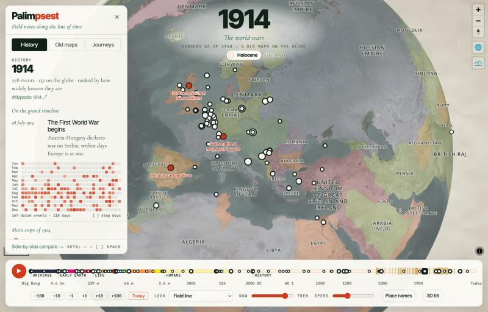
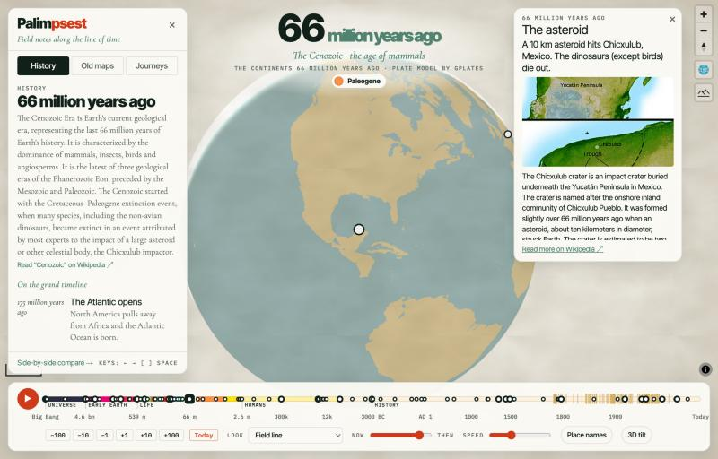
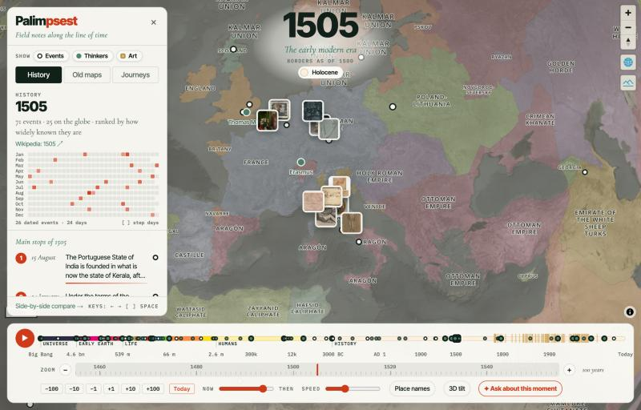
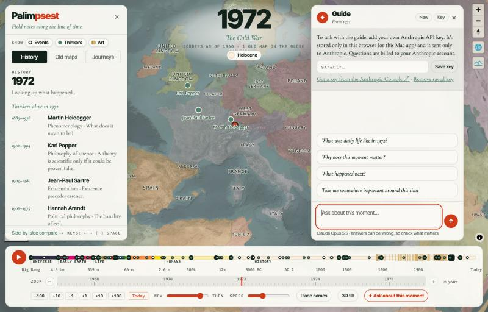

# Palimpsest tutorial

A ten-minute walk through everything Palimpsest can do. Follow along on the web at **<https://bollineni-create.github.io/palimpsest/>**, or in the Mac app.

The first time you open Palimpsest, a short tour points out each control. You can replay it any time with **Tutorial** at the bottom of the side panel (or **Help → Palimpsest Tutorial** in the Mac app).



---

## 1. Find your way around

The screen has four parts:

- **The globe**, in the middle. Drag to spin it, scroll or pinch to zoom, and press **T** (or the **3D tilt** button) to tilt into 3D terrain.
- **The year**, at the top, with its era underneath (for example *The world wars*) and the geologic period chip (*Holocene*).
- **The side panel**, on the left, with three tabs: **History**, **Old maps** and **Journeys**. Press **Esc** to hide or show it.
- **The timeline**, along the bottom: the main line, the zoom ruler, and the controls.

## 2. Search for anything

The search box at the top of the panel (press **/** or **⌘K** from anywhere) finds:

- **A moment**: type `1453`, `323 BC` or `20 July 1969` and pick *Go to*.
- **Things in Palimpsest**: landmarks, thinkers, journeys, old maps, and the events of the year on screen.
- **Anything on Wikipedia**: people, places, battles, buildings, inventions. Pick one and Palimpsest reads its date and place from Wikidata, moves the timeline there (for a person, the middle of their life), flies to the spot (for a person, their birthplace) and opens a card with a summary and picture.

Use **↑ ↓** and **Return** to choose, **Esc** to clear.

> **Try it:** search `Battle of Hastings`, then `Marie Curie`, then `Great Wall of China`.

## 3. Travel through time

**Drag the timeline.** It runs from the Big Bang on the left to today on the right. It isn't to scale: recent centuries get more room, so you can still pick out individual years. The colours are the official geologic time scale, and the labelled bands mark *Universe*, *Early Earth*, *Life*, *Humans* and *History*.

**Hover over the dots** on the line to see landmark moments, and click one to jump there. Try the big gold one near the start: the Big Bang.

**Type a moment.** Click the big year and type any of these, then press Return:

| You type | You get |
| --- | --- |
| `1453` | the year 1453 |
| `323 BC` or `-323` | the death of Alexander the Great |
| `AD 79` | the year Vesuvius buried Pompeii |
| `66 million years ago` or `66 m` | the asteroid that ended the dinosaurs |
| `4.5 bn` | the young Earth |
| `20 July 1969` or `1969-07-20` | the day of the Moon landing, with its events |
| `today` | the present |

**Fine-tune with the zoom ruler.** The thinner ruler under the timeline shows a window around the current moment. Press **+** to narrow it (down to 10 years) and **−** to widen it (up to a billion years), then drag inside it to move precisely. Click the span label (for example *100 years*) to return to the automatic span.

**Step with the keyboard.** **←** and **→** move a year at a time (hold **Shift** for ten). **Space** plays history forwards; the **Speed** slider sets how fast.

> **Try it:** type `1914`, then press **Space** and watch the borders of Europe change through the First World War.

## 4. Read what happened

The **History** tab shows what happened in the year on screen, from Wikipedia.

- **Main stops** lists the year's biggest events, ranked by impact. (Impact is estimated from how much has been written about each event's subject, so treat it as a guide, not a verdict.)
- **The calendar** (from AD 1000 onwards) has a square for every day. Brighter squares are bigger days. Click one, or press **[** and **]** to step between days. The top of the screen shows the full date, such as *Sunday 20 July*.
- **Red pins** on the globe mark where events happened. Bigger pins are bigger events. Click a pin or an event to fly there and read a summary.
- **Show all events** at the bottom lists everything in order.

Before written history there are no year-by-year lists, so the panel shows a summary of the age and the nearest landmarks on the grand timeline, with *You are here* marked.

> **Try it:** type `1969`, click the square for 20 July, then click the top event.

## 5. Explore the map

- **Click any region** to see its name in that era, who ruled it, and a Wikipedia summary. Borders come from a historical atlas and get rougher the further back you go.
- **Old maps** appear when the timeline reaches their years: London in the 1890s, Cassini's France, Switzerland edition by edition, post-war Tokyo from the air. Gold dots mark them when you're zoomed out. The **Old maps** tab lists them all, and **Side-by-side compare** (at the bottom of the panel) opens a viewer with fade, swipe and spyglass modes.
- **Now ↔ Then** blends between today's satellite imagery and the historical layers.
- **Place names** adds today's labels on top.

**Deep time.** Drag back past 5 million years ago and the satellite imagery disappears. The globe shows the continents where they actually sat, back to a billion years ago. Before that it's an ocean world, then a molten young Earth, then (before 4.54 billion years ago) no Earth at all.



> **Try it:** type `250 million years ago` to see Pangaea, then `66 m` and click the red pin in the Gulf of Mexico.

## 6. Thinkers and art

The switches at the top of the panel turn layers on and off: **Events**, **Thinkers** and **Art**.

- **Thinkers** shows the philosophers alive in that year, from Confucius and the Buddha to Hannah Arendt and Frantz Fanon, at the city where they worked. Click one for their key idea and a summary. If nobody in the list was alive that year, you'll see those who lived closest to it.
- **Art** shows public-domain works made around that time, from the Cleveland Museum of Art, as thumbnails where they were made. Click one for a large image and the museum's description. Art is richest from ancient Greece onwards and thin before about 3000 BC.



> **Try it:** type `1505` and zoom into Italy.

## 7. Take a guided journey

Open the **Journeys** tab and pick one. Palimpsest flies you from stop to stop with a caption at each; use **Next** and **Back**, or **End journey**. There are seventeen, including:

- **From the Big Bang to you**: 13.8 billion years in twelve stops
- **The Axial Age**: Confucius, the Buddha and Socrates, all in one century
- **The Silk Road**, **The age of exploration** and **Age of revolutions**
- **Renaissance art**: Florence, Milan, Rome and Venice, with the art layer on
- **The Second World War**, day by day
- **Life conquers the land** and **The great extinctions**
- **Wonders of the ancient world** and **Ice Age humans**

## 8. Ask the guide

**✦ Ask about this moment** (on the timeline) and **✦ Ask the guide** (on any card) open a chat with an AI guide. The guide knows the moment, where the globe is pointed and what's on screen, and answers like a museum guide. It can also move the globe and switch layers to show you what it's describing.



**Choosing an AI (once):** open the guide and press **Settings**. Pick one of four providers:

| Provider | Needs | Cost |
| --- | --- | --- |
| **Claude** (Anthropic) | an API key from the [Anthropic Console](https://console.anthropic.com/settings/keys) | billed to your Anthropic account |
| **ChatGPT** (OpenAI) | an API key from the [OpenAI dashboard](https://platform.openai.com/api-keys); then pick a model | billed to your OpenAI account |
| **Free models · OpenRouter** | a free [OpenRouter](https://openrouter.ai/keys) account and key; then pick one of the free models | free, with daily limits |
| **Free, no key · Pollinations** | nothing | free and anonymous, but slower and less reliable, and your questions go to Pollinations.ai |

Paste the key and press **Save key**. Keys are saved only in your browser (or the Mac app) and sent only to that provider; **Remove saved key** deletes one. Switching provider starts a fresh conversation. All four can move the globe for you, except a few free models that don't support tools: those still answer, but can't take you places.

**Things to ask:**

- "What was daily life like here?"
- "Why does this moment matter?"
- "What happened next?" (it will take you there)
- "Take me somewhere important around this time."
- "Tell me more about Erasmus." (after clicking a thinker)
- "Show me the art of this period."

**New** starts a fresh conversation. The guide can be wrong, so check anything important.

## 9. The Mac app

The repository includes a native Mac app. To build and install it:

```bash
./app/macos/build.sh
```

It opens Palimpsest in its own window, with menus for **Time Machine** (⌘1), **Side-by-side Compare** (⌘2), **Play or Pause Time** (⌘P), **Tilt to 3D** (⌘T) and **Help → Palimpsest Tutorial**. It reads the site straight from the folder you built it in and reloads within a second whenever a file changes, which makes it a live preview while you work on the code.

## Keyboard shortcuts

| Key | Does |
| --- | --- |
| `←` `→` | Step a year (Shift: ten years) |
| `[` `]` | Previous or next day with events |
| `Space` | Play or pause |
| `T` | Tilt to 3D |
| `Esc` | Show or hide the panel |
| Click the year | Type a year or a date |
| `/` or `⌘K` | Search |

## If something looks wrong

- **The globe is blank or slow.** Palimpsest loads everything live: imagery, borders, history and art. On a slow connection, give it a few seconds, especially the first time you visit an era.
- **Deep time fills in slowly.** Each ancient-continent snapshot takes about five seconds to build the first time.
- **No events for a year.** Some years have little on Wikipedia, especially outside Europe and before about AD 1000. Try the decade around it.
- **A journey stopped.** Journeys now resume from the same stop after a reload, so if the page refreshes (for example the Mac app picking up an update), you carry on where you were.
- **The guide says the key was rejected.** Check you copied the whole key (it starts with `sk-ant-`), and that your Anthropic account has credit.
